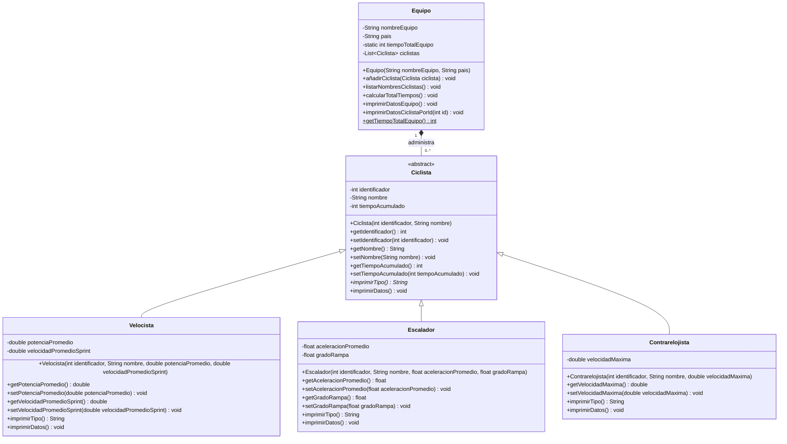

# Ejercicio de Polimorfismo con Ciclistas

Proyecto desarrollado en Java que modela los ciclistas de un equipo de carrera.
El ejercicio aplica una clase abstracta, herencia, sobrescritura de métodos y
polimorfismo para representar los distintos tipos de ciclistas.

## Integrantes

- Lauren Sofia Valderrama
- Eva Maria Diaz
- Will Stiven Franco

## Objetivos del ejercicio

- Crear una superclase abstracta llamada `Ciclista`.
- Utilizar atributos comunes y métodos compartidos.
- Definir el método abstracto `imprimirTipo()`, que debe ser implementado por
  cada tipo de ciclista.
- Crear las clases `Velocista`, `Escalador` y `Contrarelojista`.
- Administrar los ciclistas desde la clase `Equipo`.
- Aplicar polimorfismo al tratar a los diferentes ciclistas como objetos de tipo
  `Ciclista`.
- Validar los datos ingresados mediante excepciones `IllegalArgumentException`.

## Descripción de las clases

### `Ciclista` (clase abstracta)

Es la superclase de todos los ciclistas. No puede ser instanciada directamente
y contiene los datos comunes:

- `identificador`: identificador único del ciclista.
- `nombre`: nombre del ciclista.
- `tiempoAcumulado`: tiempo acumulado en minutos.
- `imprimirTipo()`: método abstracto que devuelve el tipo del ciclista.
- `imprimirDatos()`: muestra los datos generales del ciclista.

### `Velocista`

Extiende de `Ciclista` e incorpora:

- Potencia promedio en watts.
- Velocidad promedio en sprint en km/h.

Implementa `imprimirTipo()` como `"Es un Velocista"` y sobrescribe
`imprimirDatos()` para incluir sus características específicas.

### `Escalador`

Extiende de `Ciclista` e incorpora:

- Aceleración promedio en m/s².
- Grado de rampa soportada en grados.

Implementa `imprimirTipo()` como `"Es una Escaladora"` y sobrescribe
`imprimirDatos()` para mostrar sus atributos particulares.

### `Contrarelojista`

Extiende de `Ciclista` e incorpora:

- Velocidad máxima en km/h.

Implementa `imprimirTipo()` como `"Es una Contrarrelojista"` y sobrescribe
`imprimirDatos()` para mostrar la velocidad máxima.

### `Equipo`

Administra una colección de ciclistas. Sus funciones principales son:

- Agregar ciclistas al equipo.
- Listar los nombres de los integrantes.
- Calcular el tiempo total acumulado.
- Imprimir los datos generales del equipo.
- Buscar un ciclista por su identificador.

La relación con `Ciclista` se implementa mediante una lista
`List<Ciclista>`, lo que permite almacenar velocistas, escaladores y
contrarrelojistas como objetos polimórficos.

### `Main`

Contiene el método `main`:

1. Crea un equipo llamado `Los Malayas`.
2. Instancia los tres tipos de ciclistas.
3. Asigna y acumula sus tiempos.
4. Agrega los ciclistas al equipo.
5. Muestra los nombres y el tiempo total.
6. Solicita por teclado un identificador.
7. Busca y muestra los datos del ciclista correspondiente.

## Diagrama de clases



## Polimorfismo aplicado

Las clases hijas sobrescriben el método abstracto `imprimirTipo()` y el método
concreto `imprimirDatos()`. Aunque el objeto se almacene en una variable o lista
de tipo `Ciclista`, Java ejecuta la implementación correspondiente a la clase
real del objeto:

```java
Ciclista ciclista = new Velocista(101, "Stiven Franco", 800.0, 70.5);
ciclista.imprimirDatos();
```

En este caso se ejecutan los datos generales de `Ciclista` mediante
`super.imprimirDatos()` y, además, los datos específicos de `Velocista`.
Este mismo principio se usa al recorrer la lista del equipo.

## Ejecución del proyecto

Se requiere Java 17 y Maven.

Compilar el proyecto:

```bash
mvn compile
```

Ejecutar el programa:

```bash
mvn exec:java -Dexec.mainClass="com.poo.Main"
```

Si el plugin de Maven no está configurado, también puede ejecutarse así:

```bash
mvn compile
java -cp target/classes com.poo.Main
```

Ejecutar las pruebas unitarias:

```bash
mvn test
```
